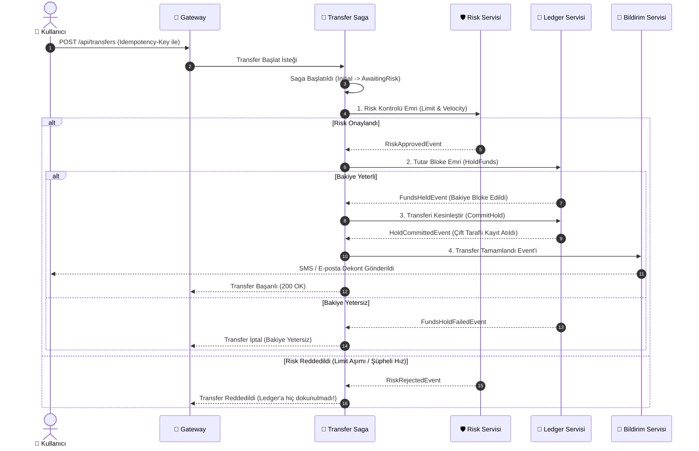

# 🐖 Kumbara — Fintech Cüzdan ve Para Transferi Platformu

> ### ⚠️ EĞİTİM AMAÇLI SİMÜLASYON — GERÇEK PARA DEĞİLDİR ⚠️
> **Bu proje eğitim ve portföy amaçlı bir fintech simülasyonudur. Gerçek para transferi yapılmaz. Herhangi bir banka veya finans kuruluşuyla bağı yoktur.**

---

## 🎯 Kumbara Nedir ve Ne Yapar?

**Kumbara**, modern bir dijital cüzdan ve para transferi platformudur. 
Finansal sistemlerin en kritik problemi olan **"Para asla kaybolamaz, bakiye eksiye düşemez ve para çift harcanamaz"** kuralını dağıtık mikroservis mimarisi üzerinde çözer ve kanıtlar.

Sistemde bir kullanıcı:
1. Farklı para birimlerinde (`TRY`, `USD`, `EUR`) **dijital cüzdan açabilir**.
2. Cüzdanına **bakiye yükleyebilir** veya cüzdanını **dondurabilir / aktif edebilir**.
3. Başka bir cüzdana **güvenli para transferi** başlatabilir.
4. Transfer başladığı anda sistem arka planda **Risk Analizi**, **Bakiye Blokesi (Hold)** ve **Çift Taraflı Muhasebe Kaydı (Commit)** adımlarını dağıtık Saga orkestrasyonuyla yönetir.
5. İşlem bittiğinde kullanıcıya anında **SMS ve E-posta bildirimi** iletilir.

---

## 🏛️ Mimari Genel Bakış (Konteyner Diyagramı)

Aşağıdaki şemada kullanıcıdan veritabanlarına kadar olan tüm veri akışı gösterilmiştir:

```mermaid
flowchart TD
    User["👤 Kullanıcı"] --> UI["🌐 Angular 18 Web UI<br/>(Signals, Standalone - Port 4200)"]
    UI --> GW["🚪 YARP API Gateway<br/>(Rate Limiting, Routing - Port 5000)"]

    subgraph Microservices ["Mikroservisler (.NET 8)"]
        ID["🔑 Identity Service<br/>(OpenIddict, JWT - Port 5001)"]
        WL["👛 Wallet Service<br/>(Cüzdan Aggregate - Port 5002)"]
        LD["📒 Ledger Service<br/>(Çift Taraflı Defter - Port 5003)"]
        TR["🔄 Transfer Service<br/>(MassTransit Saga - Port 5004)"]
        RK["🛡️ Risk Service<br/>(Strategy, Velocity - Port 5005)"]
        NT["🔔 Notification Service<br/>(Event Consumer - Port 5006)"]
    end

    GW --> ID
    GW --> WL
    GW --> LD
    GW --> TR
    GW --> RK
    GW --> NT

    subgraph Infrastructure ["Altyapı & Veritabanları"]
        SQL[("🗄️ SQL Server 2022<br/>(Database-per-Service - Port 1433)")]
        RMQ["🐰 RabbitMQ 3<br/>(Message Broker - Port 5672/15672)")]
        RD[("⚡ Redis 7<br/>(Velocity Sayaçları - Port 6379)")]
        SQ["📋 Seq<br/>(Merkezi Log Paneli - Port 8081)"]
    end

    ID --> SQL
    WL --> SQL
    LD --> SQL
    TR --> SQL
    NT --> SQL

    RK --> RD
    TR <--> RMQ
    LD <--> RMQ
    RK <--> RMQ
    NT <--> RMQ

    Microservices -.-> SQ
```

---

## 🔄 Dağıtık Para Transferi Saga Akışı

Mikroservislerde servisler kendi veritabanlarına sahip olduğu için tek bir SQL transaction'ı kullanılamaz. Kumbara, transfer sürecini **MassTransit Saga State Machine** orkestrasyonu ile yönetir:



### ⚠️ Hata Durumunda Telafi (Compensation / Rollback)
Eğer 3. adımda (Commit aşamasında) beklenmedik bir sistem hatası oluşursa, Saga anında **`ReleaseLedgerHoldCommand`** yayınlar. Ledger bloke edilen tutarı serbest bırakır ve para anında sahibinin hesabına iade edilir. **Para asla havada kalmaz!**

---

## 🛠️ Neyi, Neden Kullandık?

| Teknoloji | Projedeki Rolü | Neden Bu Teknolojiyi Seçtik? (Gerekçe) |
|---|---|---|
| **.NET 8 (C# 12)** | Tüm Backend Servisleri | Yüksek performans, Minimal hosting mimarisi, `record` (değiştirilemezlik) ve Primary Constructor desteği. |
| **SQL Server 2022** | Ana Veritabanı | Güçlü ACID garantisi, `decimal(19,4)` para hassasiyeti ve çift harcamayı önleyen yerleşik `RowVersion` desteği. |
| **Database-per-Service** | Veritabanı Mimarisi | Her servisin kendi şeması vardır. Hiçbir servis diğerinin tablosuna doğrudan erişemez ([ADR-0008](docs/architecture/ADR-0008-database-per-service.md)). |
| **RabbitMQ 3** | Asenkron Mesajlaşma | Servislerin birbirini kitlemeden güvenle haberleşmesi ve Saga event'lerinin garantili iletimi ([ADR-0007](docs/architecture/ADR-0007-rabbitmq-vs-kafka.md)). |
| **MassTransit** | Dağıtık Saga Orkestrasyonu | Karmaşık para transferi akışını ve telafi (compensation) adımlarını durum makinesi (State Machine) olarak yönetmek için ([ADR-0004](docs/architecture/ADR-0004-saga-orchestration.md)). |
| **Redis 7** | Dolandırıcılık & Hız Motoru | "Son 5 dakikada 5 işlem", "24 saatte 100.000 TL" kontrollerini SQL'i yormadan RAM üzerinde TTL ile mikrosaniyede yapmak için. |
| **YARP (Yet Another Reverse Proxy)** | API Gateway | Microsoft'un yüksek performanslı .NET yerel ters vekili. Rate Limiting (100 req/min) ve tek giriş noktası ([ADR-0009](docs/architecture/ADR-0009-yarp-vs-ocelot.md)). |
| **OpenIddict** | Kimlik ve Token Yönetimi | Güvenli JWT erişim token'ları (15 dk) ve veritabanı destekli refresh token (7 gün) mekanizması. |
| **Angular 18** | Kullanıcı Arayüzü (Web UI) | Standalone bileşenler, Angular Signals (reaktif durum), modern koyu fintech teması ve canlı Saga Stepper. |
| **Seq** | Merkezi Yapılandırılmış Loglama | 6 mikroservisin attığı tüm Serilog loglarını tek ekranda renkli ve filtreli izlemek için. |
| **NetArchTest** | Mimari Fitness Testleri | Geliştiricilerin Clean Architecture kurallarını çiğnemesini CI/CD'de otomatik engelleyen mimari polis. |

---

## 💎 Fintech Çekirdek İlkeleri (Öne Çıkan Mühendislik Kararları)

### 1. Çift Taraflı Defter (Double-Entry Bookkeeping)
* Her transfer işlemi daima **2 satır** üretir:
  * **Borç (Debit):** Gönderenin hesabından para çıkar (-100 TL).
  * **Alacak (Credit):** Alıcının hesabına para girer (+100 TL).
* Tüm sistem genelinde toplam: `(-100) + (+100) = 0` olmak zorundadır. Sistemdeki `LedgerEntry` toplamı daima **0**'dır ([ADR-0003](docs/architecture/ADR-0003-double-entry-append-only.md)).

### 2. Append-Only Defter (Asla UPDATE veya DELETE Yok)
* Muhasebe defterinde silme veya daksilleme olmaz. Hata düzeltmeleri ters kayıtla yapılır.
* `LedgerEntry` tablosuna sadece `INSERT` yapılabilir. EF Core ChangeTracker seviyesinde güncelleme/silme engellenmiştir.

### 3. Çift Harcamayı Önleme (Optimistic Concurrency & `RowVersion`)
* Aynı salisede iki transfer isteği gelirse bakiyenin eksiye düşmemesi için `AccountBalance` tablosunda `byte[] RowVersion` kullanılmıştır. Aynı satırı aynı anda değiştirmeye çalışan ikinci işlem `DbUpdateConcurrencyException` ile anında reddedilir.

### 4. Deadlock Önleme (Hesap ID Sıralaması)
* Ali Veli'ye, Veli de Ali'ye aynı anda transfer başlatırsa SQL Server kilitlenmesin diye hesaplar daima **GUID sırasına göre küçükten büyüğe (`OrderBy(x => x)`)** kilitlenir.

### 5. Transactional Outbox Deseni
* Veritabanına bakiye yazılıp tam RabbitMQ'ya mesaj atılırken elektrik kesilirse mesaj kaybolmasın diye, event mesajı bakiye ile **aynı SQL transaction'ında `OutboxMessages` tablosuna yazılır**. Sıfır veri kaybı ([ADR-0005](docs/architecture/ADR-0005-outbox-pattern.md)).

### 6. Idempotency-Key
* Kullanıcı butona art arda 5 kere tıklasa bile HTTP başlığındaki `Idempotency-Key` UUID sayesinde sistem ilk isteği çalıştırır, sonraki 4 isteğe önbellekteki eski cevabı döner. Para sadece 1 kez çekilir ([ADR-0006](docs/architecture/ADR-0006-idempotency-strategy.md)).

---

## 🌐 Servisler ve Port Haritası

| Servis Adı | Port | Swagger / Erişim Adresi | Görevi |
|---|---|---|---|
| **Web Arayüzü (Angular)** | `4200` | [http://localhost:4200](http://localhost:4200) | Dashboard, Transfer, Hareketler, Bildirimler |
| **API Gateway (YARP)** | `5000` | [http://localhost:5000](http://localhost:5000) | Tek giriş noktası, IP bazlı Rate Limiting |
| **Identity Servisi** | `5001` | [http://localhost:5001/swagger](http://localhost:5001/swagger) | Kayıt, giriş, JWT token üretimi |
| **Wallet Servisi** | `5002` | [http://localhost:5002/swagger](http://localhost:5002/swagger) | Cüzdan açma, dondurma, limit kontrolleri |
| **Ledger Servisi** | `5003` | [http://localhost:5003/swagger](http://localhost:5003/swagger) | Değiştirilemez çift taraflı defter, bakiye |
| **Transfer Servisi** | `5004` | [http://localhost:5004/swagger](http://localhost:5004/swagger) | Dağıtık MassTransit Saga durum makinesi |
| **Risk Servisi** | `5005` | [http://localhost:5005/swagger](http://localhost:5005/swagger) | Redis tabanlı hız ve limit kontrolü |
| **Notification Servisi** | `5006` | [http://localhost:5006/swagger](http://localhost:5006/swagger) | Asenkron SMS ve E-posta bildirimi |
| **Seq Log Paneli** | `8081` | [http://localhost:8081](http://localhost:8081) | Canlı merkezi log takip ekranı |
| **RabbitMQ Paneli** | `15672` | [http://localhost:15672](http://localhost:15672) | Mesaj kuyrukları (*kumbara / kumbara_secret*) |
| **SQL Server 2022** | `1433` | `localhost,1433` | Ana veritabanı (*sa / Your_Strong_Password_123!*) |

---

## 🚀 Projeyi Çalıştırma

### 1. Docker ile Tek Komutta Başlatma (Tavsiye Edilen)
```powershell
docker compose -f deploy/docker-compose.yml up -d
```
Tüm veritabanları, mesaj kuyrukları ve 6 mikroservis arka planda ayağa kalkar. Tarayıcınızdan **[http://localhost:4200](http://localhost:4200)** adresine girerek hemen kullanabilirsiniz.

### 2. Tüm Testleri Koşturma (62/62 Başarılı)
```powershell
dotnet test Kumbara.sln
```

### 3. Yük ve Dayanıklılık Testleri
```powershell
# 500 eşzamanlı kullanıcıyla k6 yük testi:
k6 run tests/Load/500-parallel-transfers.js

# RabbitMQ kapatıldığında paranın kaybolmadığını kanıtlayan Chaos testi:
powershell -ExecutionPolicy Bypass -File tests/Chaos/broker-failure-chaos.ps1
```

---

## 📄 Lisans
Bu proje MIT lisansı altında eğitim ve gösterim amacıyla açık kaynak olarak sunulmuştur.
