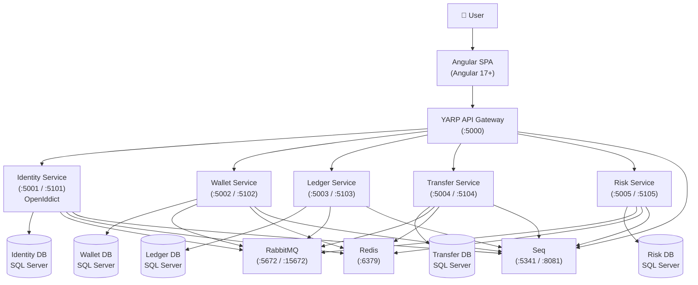

# 🐖 Kumbara

> ## ⚠️ EDUCATIONAL SIMULATION — NO REAL MONEY ⚠️
>
> **Bu proje eğitim amaçlı bir simülasyondur. Gerçek para transferi yapılmaz. Herhangi bir gerçek finansal kuruluşla ilişkisi yoktur.**
>
> *This project is an educational simulation. No real money transfers are made. It has no affiliation with any real financial institution.*

Kumbara is an educational fintech platform demonstrating microservices architecture patterns using .NET 8. It simulates a digital wallet and money transfer system to showcase distributed systems concepts such as double-entry ledger accounting, saga orchestration, transactional outbox, idempotency, and CQRS.

---

## Architecture Overview



## Services

| Service | Port (Host / Docker) | Description |
|---------|----------------------|-------------|
| **Gateway** | 5000:8080 | YARP reverse proxy — single entry point for all API calls |
| **Identity** | 5001:8080 (5101 local) | User registration, authentication, authorization (OpenIddict) |
| **Wallet** | 5002:8080 (5102 local) | Wallet creation, balance queries, account management |
| **Ledger** | 5003:8080 (5103 local) | Double-entry bookkeeping, append-only ledger entries, holds |
| **Transfer** | 5004:8080 (5104 local) | Money transfer orchestration via MassTransit Saga State Machine |
| **Risk** | 5005:8080 (5105 local) | Transaction risk evaluation and velocity counters (Redis) |

### Infrastructure

| Component | Port | Purpose |
|-----------|------|---------|
| **SQL Server** | 1433 | Relational database (one database per microservice) |
| **RabbitMQ** | 5672 / 15672 | Async messaging broker / Web Management Dashboard |
| **Redis** | 6379 | In-memory cache, velocity counters, idempotency store |
| **Seq** | 5341 / 8081 | Structured JSON log ingestion / UI dashboard |

---

## Tech Stack

| Layer | Technology |
|-------|-----------|
| **Backend** | .NET 8, ASP.NET Core, C# 12 |
| **Auth** | OpenIddict (OAuth 2.0 / OpenID Connect) |
| **Messaging** | RabbitMQ + MassTransit 8.3 |
| **ORM** | Entity Framework Core 8 |
| **Database** | SQL Server 2022 |
| **Cache** | Redis 7 |
| **Gateway** | YARP (Yet Another Reverse Proxy) |
| **Observability** | Serilog → Seq structured logging |
| **Testing** | xUnit, FluentAssertions, NetArchTest.Rules, k6 |
| **Containers** | Docker / Docker Compose |

---

## Getting Started

### Prerequisites

- [Docker Desktop](https://www.docker.com/products/docker-desktop/) (Windows/macOS) or Docker Engine (Linux)
- [.NET 8 SDK](https://dotnet.microsoft.com/download/dotnet/8.0) (for building and running tests)
- [k6](https://k6.io/docs/get-started/installation/) (optional, for load testing)

### 1. Run with Docker Compose

To start all microservices, databases, brokers, and the API gateway:

```bash
# Clone the repository
git clone https://github.com/your-org/kumbara.git
cd Kumbara

# Copy environment variables
cp .env.example .env

# Start all infrastructure and API containers
docker compose -f deploy/docker-compose.yml up -d

# Check running containers
docker compose -f deploy/docker-compose.yml ps

# View unified logs
docker compose -f deploy/docker-compose.yml logs -f
```

- **API Gateway**: `http://localhost:5000`
- **Seq Dashboard**: `http://localhost:8081` (ingestion: `http://localhost:5341`)
- **RabbitMQ Management**: `http://localhost:15672` (guest / guest)

---

## Verification & Testing

### 2. Run Test Suite (58 Passing Tests)

The solution features a comprehensive test suite of **58 automated tests** spanning:
- **Clean Architecture Fitness Tests**: Enforcing zero forbidden layer references via `NetArchTest`.
- **Domain Invariant Tests**: Mathematically verifying double-entry bookkeeping rules ($\sum \text{Debit} + \sum \text{Credit} = 0$), non-negative balance enforcement, and total system funds conservation (`ILedgerInvariantChecker`).
- **Saga State Machine Tests**: Simulating happy paths, risk rejections, insufficient funds, and compensation rollback using MassTransit's in-memory test harness.
- **Idempotency Tests**: Ensuring duplicate HTTP requests return cached responses with zero double-processing.

```bash
# Run all tests across the solution
dotnet test Kumbara.sln
```

Expected result:
```text
Passed!  - Failed: 0, Passed: 58, Skipped: 0, Total: 58
```

---

### 3. Run Load Testing (k6)

Simulate concurrent workloads through the YARP API Gateway:

```bash
# 500 concurrent virtual users executing parallel money transfers (validates P95 < 300ms)
k6 run tests/Load/500-parallel-transfers.js

# 100-burst idempotency test (100 simultaneous requests with the identical Idempotency-Key)
k6 run tests/Load/idempotency-100-burst.js
```

---

### 4. Run Chaos Resilience Testing

Simulate a sudden RabbitMQ broker crash during active transfer transactions to verify transactional outbox durability, fail-safe degradation, and zero money loss:

```powershell
# Run the automated PowerShell chaos resilience script
powershell -ExecutionPolicy Bypass -File tests/Chaos/broker-failure-chaos.ps1
```

For full details on chaos testing procedures and mathematical balance verification, see [tests/Chaos/README.md](tests/Chaos/README.md).

---

## Project Structure

```
Kumbara/
├── .github/
│   └── workflows/
│       └── ci.yml                       # GitHub Actions CI pipeline
├── src/
│   ├── Gateway/
│   │   └── Kumbara.Gateway/              # YARP API Gateway (:5000)
│   ├── Services/
│   │   ├── Identity/                     # OpenIddict Auth Server (:5001)
│   │   ├── Wallet/                       # Wallet & Accounts Service (:5002)
│   │   ├── Ledger/                       # Double-Entry Ledger Service (:5003)
│   │   ├── Transfer/                     # MassTransit Saga Coordinator (:5004)
│   │   └── Risk/                         # Fraud & Velocity Engine (:5005)
│   └── BuildingBlocks/
│       ├── Kumbara.BuildingBlocks.Contracts/   # Integration events & saga commands
│       ├── Kumbara.BuildingBlocks.Outbox/      # Transactional outbox
│       └── Kumbara.BuildingBlocks.Idempotency/ # Idempotency middleware & cache
├── tests/
│   ├── Kumbara.Architecture.Tests/      # ArchUnit fitness, Saga, & Invariant tests (57 tests)
│   ├── Kumbara.Integration.Tests/       # API integration tests (1 test)
│   ├── Load/                            # k6 load testing scripts (500 VUs, burst)
│   └── Chaos/                           # Broker crash simulation & recovery scripts
├── docs/
│   └── architecture/                    # ADRs (0001-0010), C4 diagrams, Sequence diagrams, NFRs
├── deploy/
│   ├── docker-compose.yml               # Production/simulation composition
│   └── docker-compose.override.yml      # Local development overrides
├── .env.example
├── LICENSE
└── Kumbara.sln
```

---

## Key Architecture Patterns

### 🏦 Double-Entry Ledger
Every financial transaction creates exactly two entries (debit + credit) that sum to zero. The ledger is **append-only** — corrections are made via reversal entries, never updates or deletes. See [ADR-0003](docs/architecture/ADR-0003-double-entry-append-only.md).

### 🔄 Saga Orchestration
Money transfers are coordinated by a MassTransit Saga State Machine in the Transfer service. The saga orchestrates risk checks, ledger holds, and commits with full compensation on failure. See [ADR-0004](docs/architecture/ADR-0004-saga-orchestration.md) and [Sequence Diagrams](docs/architecture/sequence-saga-happy.md).

### 📤 Transactional Outbox
Database changes and event publishing are made atomic by writing events to an outbox table within the same DB transaction. A background publisher relays events to RabbitMQ. See [ADR-0005](docs/architecture/ADR-0005-outbox-pattern.md).

### 🔑 Idempotency
All mutating API endpoints require an `Idempotency-Key` header. Duplicate requests return the cached response, preventing double-processing. See [ADR-0006](docs/architecture/ADR-0006-idempotency-strategy.md).

### 🛡️ Real-Time Velocity Checks
The Risk service evaluates single-transaction limits (50,000 TRY), 24-hour cumulative velocities (100,000 TRY), and frequency spikes (5 requests / 5 min) using Redis sliding windows before any funds are held.

---

## Documentation

- [Architecture Decision Records (ADRs 0001–0010)](docs/architecture/ADR-README.md)
- [C4 Container Diagram](docs/architecture/c4-container.md)
- [Saga Sequence Diagram — Happy Path](docs/architecture/sequence-saga-happy.md)
- [Saga Sequence Diagram — Failure & Compensation](docs/architecture/sequence-saga-failure.md)
- [Non-Functional Requirements & Verification](docs/architecture/nfr.md)
- [Chaos Resilience Runbook](tests/Chaos/README.md)

---

## Simulation Disclaimer

⚠️ **EDUCATIONAL SIMULATION ONLY**: This project is strictly designed for educational purposes to demonstrate microservices architecture patterns. No real currency is accepted, held, or transferred.

---

## License

This project is licensed under the MIT License — see the [LICENSE](LICENSE) file for details.
