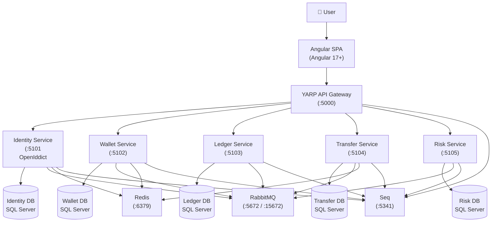

# 🐖 Kumbara

> ## ⚠️ EDUCATIONAL SIMULATION — NO REAL MONEY ⚠️
>
> **Bu proje eğitim amaçlı bir simülasyondur. Gerçek para transferi yapılmaz. Herhangi bir gerçek finansal kuruluşla ilişkisi yoktur.**
>
> *This project is an educational simulation. No real money transfers are made. It has no affiliation with any real financial institution.*

Kumbara is an educational fintech platform demonstrating microservices architecture patterns using .NET 8. It simulates a digital wallet and money transfer system to showcase distributed systems concepts such as double-entry ledger accounting, saga orchestration, transactional outbox, idempotency, and CQRS.

---

## Architecture Overview



## Services

| Service | Port | Description |
|---------|------|-------------|
| **Gateway** | 5000 | YARP reverse proxy — single entry point for all API calls |
| **Identity** | 5101 | User registration, authentication, authorization (OpenIddict) |
| **Wallet** | 5102 | Wallet creation, balance queries, account management |
| **Ledger** | 5103 | Double-entry bookkeeping, append-only ledger entries |
| **Transfer** | 5104 | Money transfer orchestration via MassTransit Saga |
| **Risk** | 5105 | Transaction risk assessment and fraud checks |

### Infrastructure

| Component | Port | Purpose |
|-----------|------|---------|
| **SQL Server** | 1433 | Relational database (one schema per service) |
| **RabbitMQ** | 5672 / 15672 | Async messaging / Management UI |
| **Redis** | 6379 | Caching, idempotency key store |
| **Seq** | 5341 | Structured log aggregation |

## Tech Stack

| Layer | Technology |
|-------|-----------|
| **Backend** | .NET 8, ASP.NET Core |
| **Auth** | OpenIddict (OAuth 2.0 / OpenID Connect) |
| **Messaging** | RabbitMQ + MassTransit |
| **ORM** | Entity Framework Core |
| **Database** | SQL Server |
| **Cache** | Redis |
| **Gateway** | YARP (Yet Another Reverse Proxy) |
| **Frontend** | Angular 17+ |
| **Logging** | Serilog → Seq |
| **Containers** | Docker / Docker Compose |

## Getting Started

### Prerequisites

- [Docker Desktop](https://www.docker.com/products/docker-desktop/) (Windows/macOS) or Docker Engine (Linux)
- [.NET 8 SDK](https://dotnet.microsoft.com/download/dotnet/8.0) (for local development)
- [Node.js 18+](https://nodejs.org/) (for Angular frontend)

### Run with Docker Compose

```bash
# Clone the repository
git clone https://github.com/your-org/kumbara.git
cd kumbara

# Copy environment file
cp .env.example .env

# Start all services
docker compose up -d

# View logs
docker compose logs -f
```

The API Gateway will be available at `http://localhost:5000`.
Seq dashboard at `http://localhost:5341`.
RabbitMQ Management UI at `http://localhost:15672` (guest/guest).

### Run Locally (Development)

```bash
# Start infrastructure only
docker compose up -d sqlserver rabbitmq redis seq

# Run each service (in separate terminals)
dotnet run --project src/Services/Identity/Kumbara.Identity.Api
dotnet run --project src/Services/Wallet/Kumbara.Wallet.Api
dotnet run --project src/Services/Ledger/Kumbara.Ledger.Api
dotnet run --project src/Services/Transfer/Kumbara.Transfer.Api
dotnet run --project src/Services/Risk/Kumbara.Risk.Api
dotnet run --project src/Gateway/Kumbara.Gateway
```

## Project Structure

```
Kumbara/
├── src/
│   ├── Gateway/
│   │   └── Kumbara.Gateway/              # YARP API Gateway
│   ├── Services/
│   │   ├── Identity/
│   │   │   ├── Kumbara.Identity.Domain/        # Entities, value objects
│   │   │   ├── Kumbara.Identity.Application/   # Use cases, interfaces
│   │   │   ├── Kumbara.Identity.Infrastructure/ # EF Core, OpenIddict
│   │   │   └── Kumbara.Identity.Api/           # Controllers, middleware
│   │   ├── Wallet/   (same 4-layer structure)
│   │   ├── Ledger/   (same 4-layer structure)
│   │   ├── Transfer/ (same 4-layer structure)
│   │   └── Risk/     (same 4-layer structure)
│   └── BuildingBlocks/
│       ├── Kumbara.BuildingBlocks.Contracts/   # Shared interfaces, events
│       ├── Kumbara.BuildingBlocks.Outbox/      # Transactional outbox
│       └── Kumbara.BuildingBlocks.Idempotency/ # Idempotency infrastructure
├── tests/
│   ├── Kumbara.Architecture.Tests/      # ArchUnit-style fitness tests
│   └── Kumbara.Integration.Tests/       # Integration / API tests
├── docs/
│   └── architecture/                    # ADRs, C4 diagrams, NFRs
├── deploy/                              # Deployment configs
├── docker-compose.yml
├── .env.example
└── Kumbara.sln
```

## Key Architecture Patterns

### 🏦 Double-Entry Ledger
Every financial transaction creates exactly two entries (debit + credit) that sum to zero. The ledger is **append-only** — corrections are made via reversal entries, never updates or deletes. See [ADR-0003](docs/architecture/ADR-0003-double-entry-append-only.md).

### 🔄 Saga Orchestration
Money transfers are coordinated by a MassTransit Saga State Machine in the Transfer service. The saga orchestrates risk checks, ledger holds, and commits with full compensation on failure. See [ADR-0004](docs/architecture/ADR-0004-saga-orchestration.md).

### 📤 Transactional Outbox
Database changes and event publishing are made atomic by writing events to an outbox table within the same DB transaction. A background publisher relays events to RabbitMQ. See [ADR-0005](docs/architecture/ADR-0005-outbox-pattern.md).

### 🔑 Idempotency
All mutating API endpoints require an `Idempotency-Key` header. Duplicate requests return the cached response, preventing double-processing. See [ADR-0006](docs/architecture/ADR-0006-idempotency-strategy.md).

### 📊 CQRS
Command and query responsibilities are separated at the application layer, allowing optimized read models and write models.

## Documentation

- [Architecture Decision Records (ADRs)](docs/architecture/ADR-README.md)
- [C4 Container Diagram](docs/architecture/c4-container.md)
- [Non-Functional Requirements](docs/architecture/nfr.md)

## License

This project is licensed under the MIT License — see the [LICENSE](LICENSE) file for details.
