# C4 Model: Container Diagram

This document presents the **C4 Container-level** architecture of Kumbara. It details the runtime containers (applications, services, datastores, brokers) that compose the system, their technical protocols, and their interactions.

## C4 Container Mermaid Diagram

```mermaid
graph TB
    %% Users
    User["👤 Customer / User<br/>[Person]<br/>Interacts with financial services via web browser"]

    %% Frontends
    SPA["💻 Single-Page Application (SPA)<br/>[Container: Angular 17+]<br/>Delivers wallet dashboard, transaction history, and money transfer UI"]

    %% API Gateway
    Gateway["🚪 API Gateway<br/>[Container: YARP / ASP.NET Core 8]<br/>Port: 5000<br/>Reverse proxy routing, JWT forwarding, rate limiting, SSL termination"]

    %% Microservices
    subgraph Microservices ["Microservices (.NET 8 / ASP.NET Core)"]
        Identity["🔐 Identity Service<br/>[Container: ASP.NET Core 8]<br/>Port: 5101<br/>Authentication, user registration, token issuance (OpenIddict)"]
        Wallet["👛 Wallet Service<br/>[Container: ASP.NET Core 8]<br/>Port: 5102<br/>Wallet management, account balance query view, owner profile"]
        Ledger["📒 Ledger Service<br/>[Container: ASP.NET Core 8]<br/>Port: 5103<br/>Double-entry accounting, append-only journal, balance recalculation"]
        Transfer["💸 Transfer Service<br/>[Container: ASP.NET Core 8]<br/>Port: 5104<br/>Transfer saga coordinator (MassTransit State Machine)"]
        Risk["🛡️ Risk Service<br/>[Container: ASP.NET Core 8]<br/>Port: 5105<br/>Risk rules evaluation, velocity checks, fraud detection simulation"]
    end

    %% Datastores
    subgraph DataStorage ["Datastores (Database-per-Service)"]
        IdentityDb[("🗄️ Identity DB<br/>[SQL Server]<br/>Users, Credentials, OAuth Tokens")]
        WalletDb[("🗄️ Wallet DB<br/>[SQL Server]<br/>Wallets, Account Profiles")]
        LedgerDb[("🗄️ Ledger DB<br/>[SQL Server]<br/>LedgerEntries, AccountBalances, Outbox")]
        TransferDb[("🗄️ Transfer DB<br/>[SQL Server]<br/>Transfers, Saga State, Outbox")]
        RiskDb[("🗄️ Risk DB<br/>[SQL Server]<br/>RiskEvaluations, FraudRules")]
    end

    %% Messaging & Observability Infrastructure
    subgraph Infrastructure ["Shared Infrastructure"]
        RabbitMQ["📨 RabbitMQ<br/>[Message Broker]<br/>Ports: 5672, 15672<br/>Asynchronous event-driven pub/sub and command queues"]
        Redis["⚡ Redis Cache<br/>[In-Memory Cache / Key-Value]<br/>Port: 6379<br/>Idempotency key storage, distributed caching"]
        Seq["📊 Seq Log Server<br/>[Observability Engine]<br/>Port: 5341<br/>Centralized structured logging and distributed trace analysis"]
    end

    %% User Interactions
    User -->|"Visits web application<br/>[HTTPS]"| SPA
    SPA -->|"Performs REST API calls with JWT<br/>[JSON/HTTPS]"| Gateway

    %% Gateway Routing
    Gateway -->|"Proxies auth & token endpoints<br/>[HTTP/REST]"| Identity
    Gateway -->|"Proxies wallet endpoints<br/>[HTTP/REST]"| Wallet
    Gateway -->|"Proxies ledger read queries<br/>[HTTP/REST]"| Ledger
    Gateway -->|"Proxies transfer commands<br/>[HTTP/REST]"| Transfer
    Gateway -->|"Proxies risk inspection<br/>[HTTP/REST]"| Risk

    %% Database connections
    Identity -->|"Reads/Writes via EF Core<br/>[TDS/TCP:1433]"| IdentityDb
    Wallet -->|"Reads/Writes via EF Core<br/>[TDS/TCP:1433]"| WalletDb
    Ledger -->|"Reads/Writes via EF Core<br/>[TDS/TCP:1433]"| LedgerDb
    Transfer -->|"Reads/Writes via EF Core<br/>[TDS/TCP:1433]"| TransferDb
    Risk -->|"Reads/Writes via EF Core<br/>[TDS/TCP:1433]"| RiskDb

    %% Event Messaging
    Identity -->|"Publishes UserRegisteredEvent<br/>[MassTransit/AMQP]"| RabbitMQ
    Wallet -->|"Consumes UserRegisteredEvent / Publishes WalletCreated<br/>[MassTransit/AMQP]"| RabbitMQ
    Transfer -->|"Publishes StartTransfer / Consumes Saga events<br/>[MassTransit/AMQP]"| RabbitMQ
    Ledger -->|"Consumes Hold/Commit commands / Publishes HoldPlaced<br/>[MassTransit/AMQP]"| RabbitMQ
    Risk -->|"Consumes RiskCheckCommand / Publishes RiskEvaluated<br/>[MassTransit/AMQP]"| RabbitMQ

    %% Caching & Idempotency
    Gateway -->|"Validates IP rate limits<br/>[RESP]"| Redis
    Transfer -->|"Checks & saves Idempotency keys<br/>[RESP]"| Redis
    Ledger -->|"Checks & saves Idempotency keys<br/>[RESP]"| Redis

    %% Structured Logging
    Gateway -.->|"Structured JSON logs via Serilog<br/>[HTTP:5341]"| Seq
    Identity -.->|"Structured JSON logs via Serilog<br/>[HTTP:5341]"| Seq
    Wallet -.->|"Structured JSON logs via Serilog<br/>[HTTP:5341]"| Seq
    Ledger -.->|"Structured JSON logs via Serilog<br/>[HTTP:5341]"| Seq
    Transfer -.->|"Structured JSON logs via Serilog<br/>[HTTP:5341]"| Seq
    Risk -.->|"Structured JSON logs via Serilog<br/>[HTTP:5341]"| Seq
```

## Container Responsibilities

| Container | Technology | Responsibilities |
|---|---|---|
| **Single-Page Application** | Angular 17+, TypeScript | User interface providing authentication views, wallet balance displays, transfer initiation forms, and real-time transaction history. |
| **API Gateway** | YARP, ASP.NET Core 8 | Reverse proxy acting as the unified entry point (`:5000`). Handles route forwarding, JWT validation, global CORS, and distributed tracing propagation. |
| **Identity Service** | ASP.NET Core 8, OpenIddict | OAuth2 / OpenID Connect authorization server. Handles user registration, credentials hashing, JWT token issuance, and claims management. |
| **Wallet Service** | ASP.NET Core 8, EF Core | High-level user wallet lifecycle. Consumes user registration events to automatically create default wallets. Serves client balance views. |
| **Ledger Service** | ASP.NET Core 8, EF Core | Core accounting engine. Records append-only debit and credit ledger entries summing to zero. Handles balance holds and commits with optimistic concurrency. |
| **Transfer Service** | ASP.NET Core 8, MassTransit Saga | Multi-step saga orchestrator for money transfers. Coordinates risk evaluation, ledger holds, ledger commit/compensation workflows with state persistence. |
| **Risk Service** | ASP.NET Core 8 | Rule-based fraud and risk evaluation engine. Analyzes transfer velocities, threshold limits, and suspicious recipient profiles. |
| **Datastores** | Microsoft SQL Server 2022 | Dedicated logical/physical databases per service ensuring zero cross-service data coupling. |
| **RabbitMQ** | RabbitMQ 3.x | Asynchronous AMQP message broker powering MassTransit event pub/sub, saga messaging, and transactional outbox delivery. |
| **Redis** | Redis 7.x | High-performance in-memory key-value store for API idempotency keys and distributed caching. |
| **Seq** | Datalust Seq | Central log aggregator indexing Serilog events, correlation IDs, and distributed tracing payloads. |
