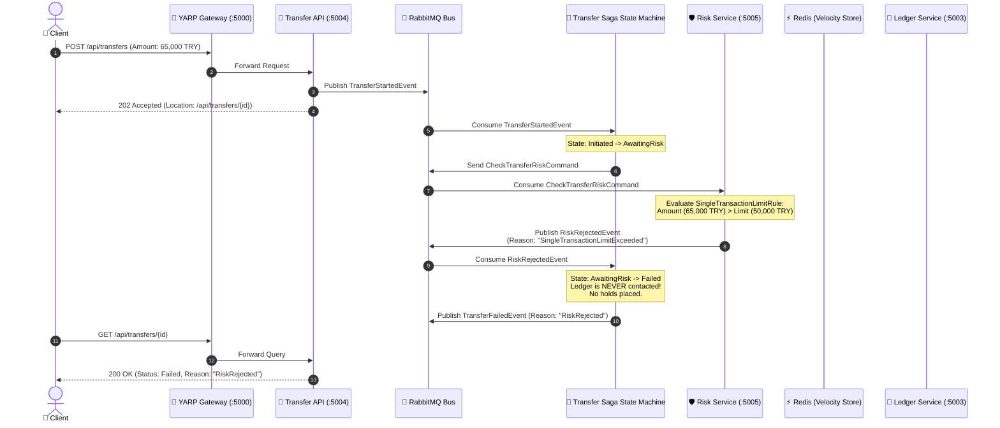
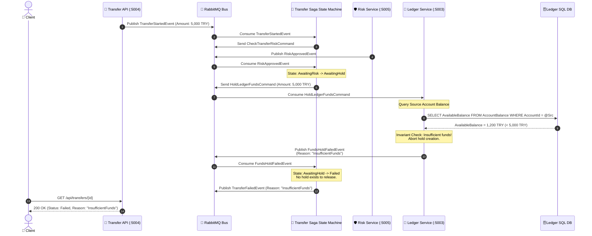
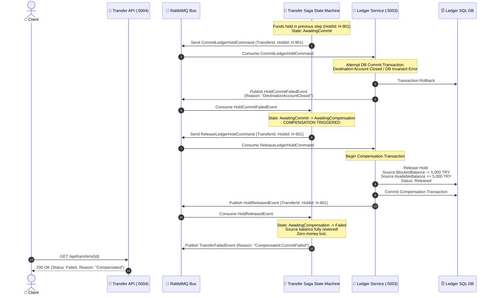

# Sequence Diagram: Transfer Saga — Failure & Compensation Scenarios

This document details the three primary failure paths in Kumbara's distributed money transfer flow, demonstrating how the MassTransit Saga State Machine handles rejections, resource shortages, and compensation rollback.

---

## Scenario A: Risk Rejected (Fail Early — Zero Ledger Impact)

When a transfer violates risk policies (e.g. amount exceeds 50,000 TRY, 24h rolling velocity exceeds 100,000 TRY, or high frequency activity detected), the Risk Service publishes `RiskRejectedEvent`. The saga transitions immediately to `Failed` without dispatching commands to the Ledger Service.

---

## Scenario B: Insufficient Funds (Hold Rejected — Clean Termination)

When risk evaluation passes, but the source account does not possess sufficient `AvailableBalance`, the Ledger Service rejects the hold request with `FundsHoldFailedEvent`. The saga transitions cleanly to `Failed` with no compensation required since no funds were held.

---

## Scenario C: Commit Failure & Compensation (Hold Released — Balance Restored)

When funds have been held successfully (`FundsHeldEvent`), but committing the transfer fails (e.g., destination account closed, optimistic locking failure, or database error), the saga enters compensation mode. It issues `ReleaseLedgerHoldCommand`, restoring the source account's available balance and transitioning to `Failed` (Compensated).

## Summary of Failure Scenarios

| Failure Point | Triggering Event | Saga Transition | Compensation Action | Net Financial Impact |
|---|---|---|---|---|
| **Risk Validation** | `RiskRejectedEvent` | `AwaitingRisk` $\to$ `Failed` | None required. | Zero change in balances; no ledger records created. |
| **Balance Check** | `FundsHoldFailedEvent` | `AwaitingHold` $\to$ `Failed` | None required. | Zero change in balances; no hold placed. |
| **Commit Execution** | `HoldCommitFailedEvent` | `AwaitingCommit` $\to$ `AwaitingCompensation` $\to$ `Failed` | `ReleaseLedgerHoldCommand` unblocks reserved funds. | Temporary hold released; balances restored to pre-transfer state. |
