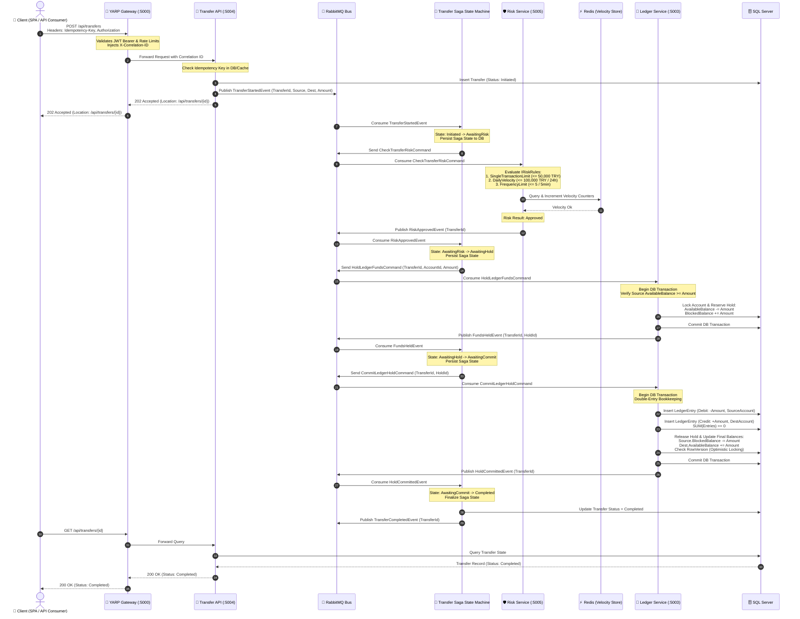

# Sequence Diagram: Transfer Saga — Happy Path

This document illustrates the end-to-end execution flow of a successful money transfer in the **Kumbara** platform, coordinated via the MassTransit Saga State Machine (`TransferStateMachine`).

## Architectural Flow Overview

1. **Client Submission**: Client sends an asynchronous transfer request to the API Gateway with an `Idempotency-Key`.
2. **Gateway Dispatch**: Gateway proxies to Transfer Service; Transfer initiates saga state and immediately returns `202 Accepted`.
3. **Risk Evaluation**: Saga requests risk verification from the Risk Service; Redis velocity counters are evaluated and approved.
4. **Ledger Hold**: Saga dispatches fund hold command to Ledger Service; funds are reserved on source account.
5. **Ledger Commit**: Saga dispatches commit command; Ledger creates double-entry debit/credit entries and updates cached balances.
6. **Completion**: Saga reaches final `Completed` state and publishes `TransferCompletedEvent`.

---

## Detailed Sequence Diagram

## Key State Transitions

| Phase | State Machine State | Trigger Message | Action Taken |
|---|---|---|---|
| **Initiation** | `Initial` $\to$ `AwaitingRisk` | `TransferStartedEvent` | Persists saga instance; dispatches `CheckTransferRiskCommand`. |
| **Risk Check** | `AwaitingRisk` $\to$ `AwaitingHold` | `RiskApprovedEvent` | Updates saga; dispatches `HoldLedgerFundsCommand`. |
| **Fund Hold** | `AwaitingHold` $\to$ `AwaitingCommit` | `FundsHeldEvent` | Records `HoldId`; dispatches `CommitLedgerHoldCommand`. |
| **Commit** | `AwaitingCommit` $\to$ `Completed` | `HoldCommittedEvent` | Updates transfer entity to `Completed`; publishes `TransferCompletedEvent`. |
