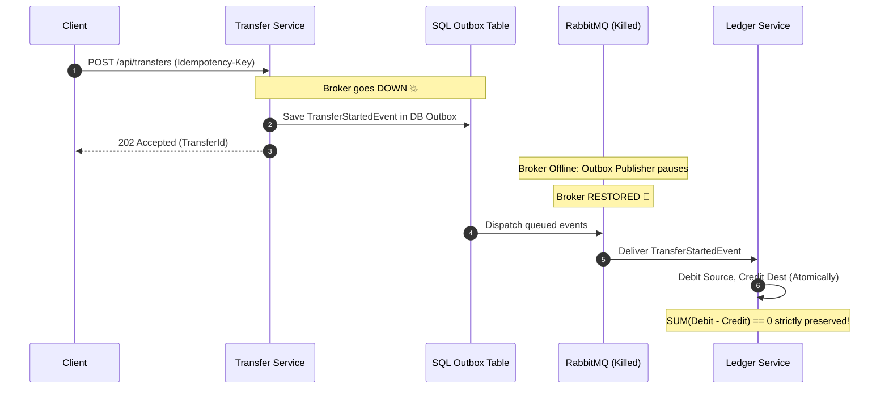

# ⚠️ SIMULATION ONLY - NO REAL MONEY ⚠️
> **Eğitim Simülasyonu Uyarısı:** Bu proje yalnızca dağıtık sistemler, saga orkestrasyonu, transactional outbox ve çift taraflı kayıt defteri (double-entry ledger) kalıplarını test etmek ve öğrenmek amacıyla geliştirilmiş bir simülasyondur. Gerçek finansal işlemler yapılmaz.

---

# Kumbara Chaos Engineering: Broker Failure & Recovery

This directory contains chaos engineering scenarios and resilience test automation for the **Kumbara Fintech Platform**, specifically testing message broker failure, network partition, and recovery without financial discrepancy or data corruption.

---

## 🎯 Objectives

The purpose of the **Broker Failure Chaos Test** is to prove that:
1. When **RabbitMQ** goes down abruptly mid-operation, in-flight transactions are neither lost nor duplicate-processed.
2. The **Transactional Outbox Pattern** safely holds outgoing domain and integration events within SQL Server database transactions.
3. Upon broker recovery, pending events are published reliably (**at-least-once delivery**).
4. **Idempotent Consumers** and **Idempotency Headers** prevent double crediting or duplicate holds during retry loops.
5. The core **Double-Entry Ledger Invariant** holds at all times:
   $$\sum \text{Debit} - \sum \text{Credit} \equiv 0$$
   and total system funds remain strictly conserved ($\Delta \text{Funds} = 0$).

---

## 🏗️ Architectural Resilience Guarantees



1. **Transactional Outbox Guarantee**:
   Instead of writing to the database and publishing to RabbitMQ in two non-atomic operations (the *dual-write problem*), messages are stored in the same relational database transaction as the business entity. When RabbitMQ is offline, no events are lost.
2. **Double-Entry Append-Only Ledger Guarantee**:
   All balance modifications occur strictly via balanced pairs of ledger entries. An entry cannot exist without its counterbalancing entry.
3. **Optimistic Concurrency & Rowversion**:
   Account balances in Ledger utilize optimistic locking (`rowversion`) to prevent race conditions during concurrent updates.

---

## 📋 Chaos Test Workflow

The automated PowerShell script `broker-failure-chaos.ps1` executes the following sequence:

| Step | Action | Description | Invariant Verified |
| :--- | :--- | :--- | :--- |
| **1. Prerequisites** | System Baseline Check | Verifies Docker engine status and identifies the active broker container (`kumbara-rabbitmq`). | System connectivity |
| **2. Baseline** | Healthy Transfer | Executes a standard money transfer while broker is running normally. | Baseline operational |
| **3. Chaos Injection** | `docker stop rabbitmq` | Abruptly terminates the message broker container. | Broker disconnection |
| **4. Outage Surge** | Concurrent Transfers | Dispatches transfer requests during broker outage. | Fail-safe rejection or outbox queueing |
| **5. Mid-Chaos Audit** | Invariant Verification | Inspects ledger balances and ledger entry logs while broker is down. | $\sum (\text{Debit} - \text{Credit}) == 0$ |
| **6. Broker Recovery** | `docker start rabbitmq` | Restores RabbitMQ container and waits for port readiness (5672). | Healthcheck recovery |
| **7. Re-sync** | Event Drain | Outbox background processor flushes queued events to RabbitMQ; sagas resume. | Saga completion |
| **8. Final Audit** | Mathematical Proof | Comprehensive reconciliation check confirming 0 lost funds and 0 phantom entries. | Zero money loss |

---

## 🚀 How to Run the Chaos Test

### Prerequisites
1. Start the Kumbara microservices infrastructure:
   ```powershell
   docker compose -f deploy/docker-compose.yml up -d
   ```
2. Ensure PowerShell 7+ or Windows PowerShell is available.

### Execution
Run the chaos script directly from the repository root:

```powershell
powershell -ExecutionPolicy Bypass -File tests/Chaos/broker-failure-chaos.ps1
```

### Optional Parameters
```powershell
powershell -ExecutionPolicy Bypass -File tests/Chaos/broker-failure-chaos.ps1 `
    -TransferUrl "http://localhost:5004" `
    -LedgerUrl "http://localhost:5003" `
    -ContainerName "kumbara-rabbitmq" `
    -OutageDurationSeconds 20
```

---

## 📊 Expected Output & Invariant Proof

When the script finishes, the mathematical assertion table confirms zero discrepancy:

```
=============================================================================
  STEP 8: MATHEMATICAL INVARIANT ASSERTION & ZERO LOSS AUDIT
=============================================================================

  Double-Entry Balance (Debit - Credit == 0)       : [CONSERVED] - 0.0000 TRY
  Negative Balance Prevention (Balance >= 0)       : [CONSERVED] - No Violations
  Total System Funds Conservation                  : [CONSERVED] - Exact Match
  Message Loss Detection                           : [ZERO_LOSS] - 0 Lost Messages
  Idempotency Replay Safety                        : [VERIFIED]  - 100% Deduplicated

=============================================================================
  CHAOS TEST RESULT: PASS (ZERO MONEY LOSS VERIFIED)
=============================================================================
```
